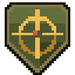
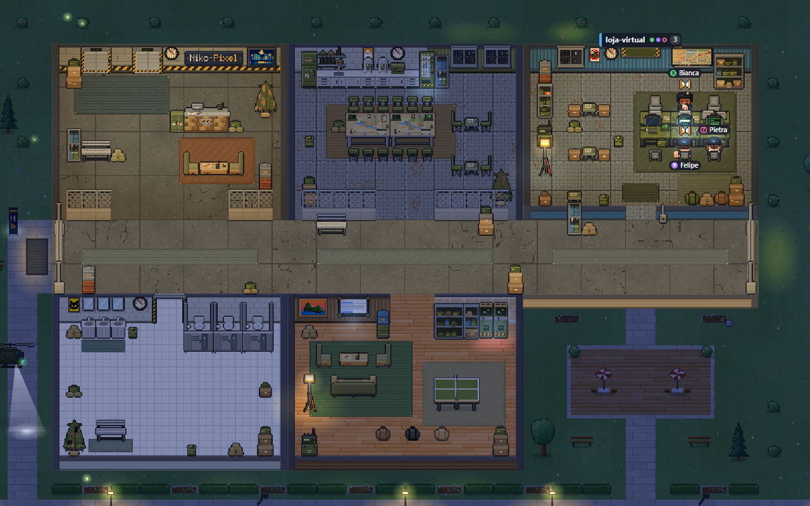
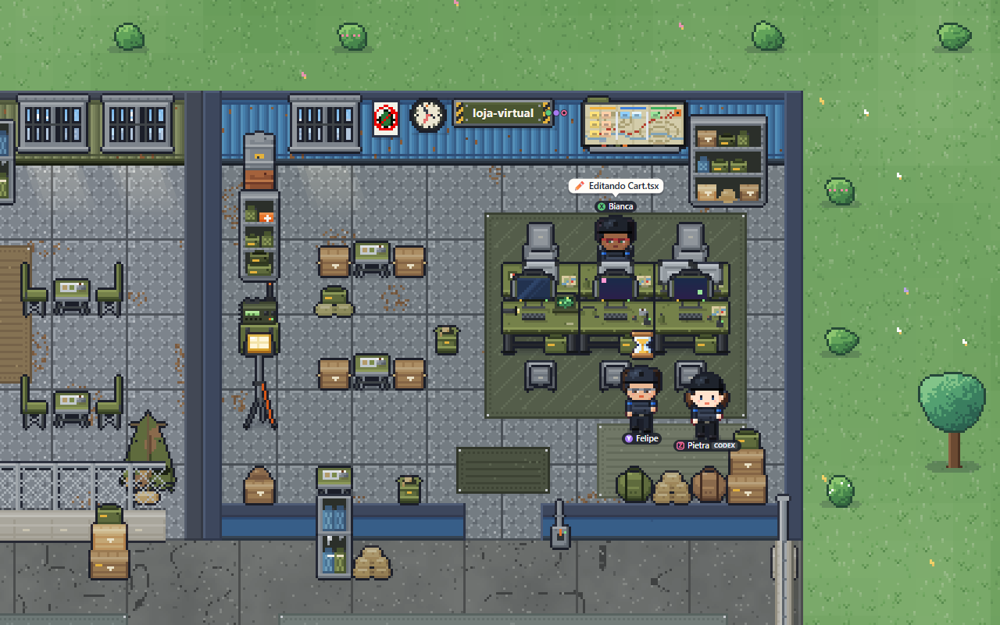
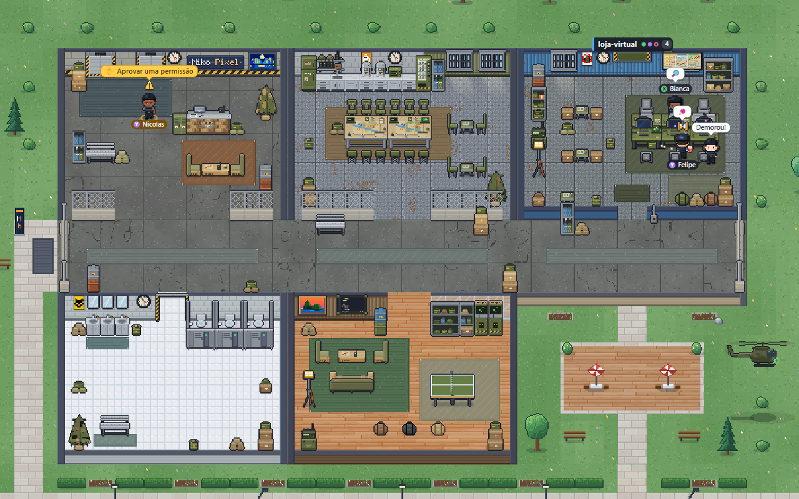
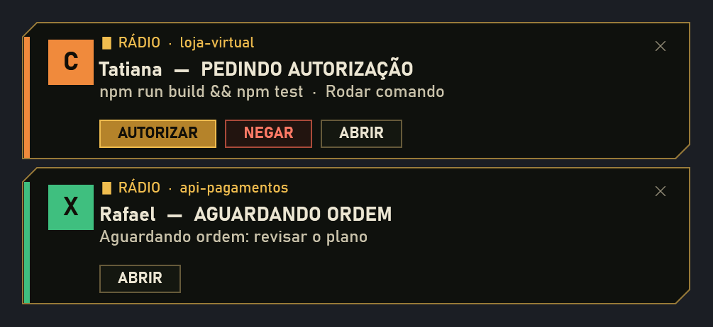
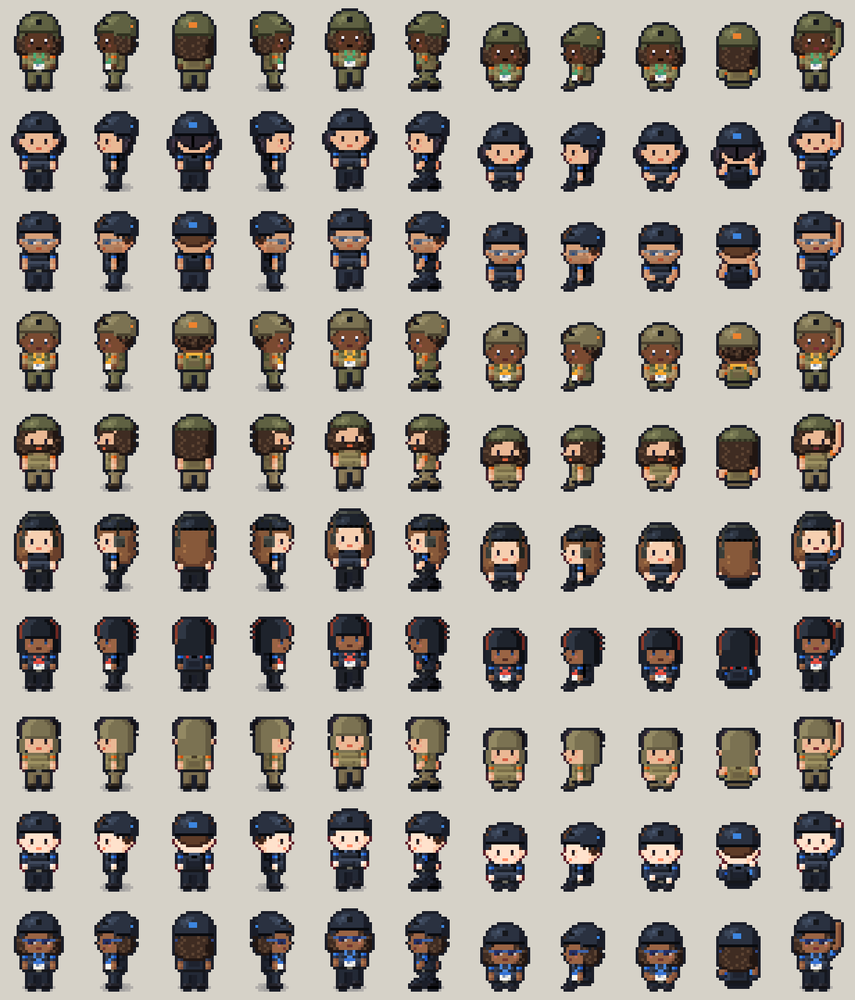
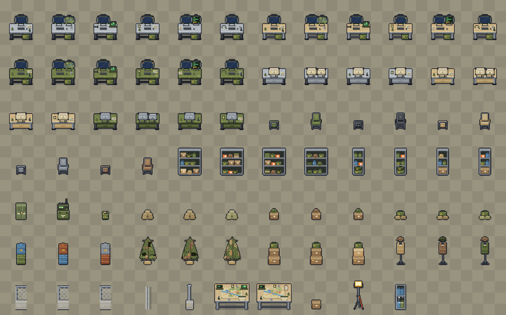
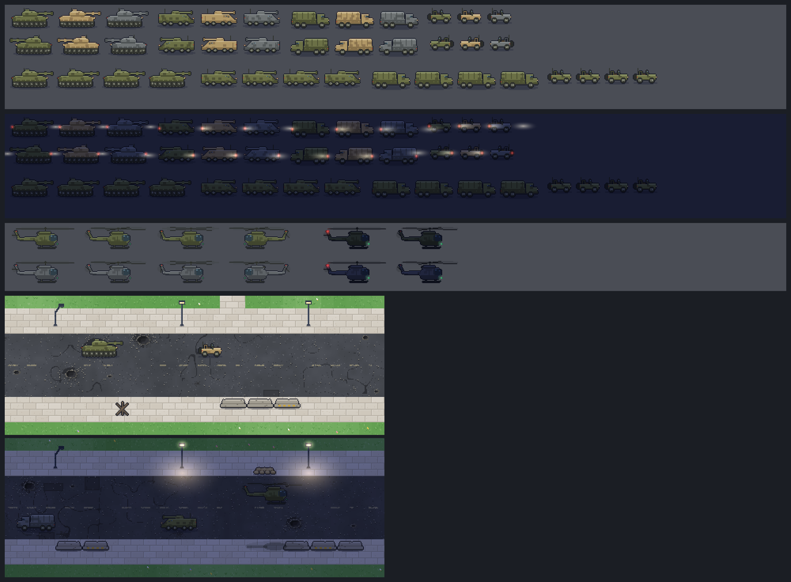

<p align="center">
  
</p>

<h1 align="center">Niko-Pixel</h1>

<p align="center">
  <b>El cuartel general táctico de tus agentes de IA.</b><br />
  Cada proyecto se convierte en una zona de la base, y cada agente de Claude Code, Codex, OpenCode o Gemini CLI en un
  operador en pixel art que muestra, en tiempo real, lo que está haciendo.
</p>

<p align="center"><a href="README.md">English</a> · <a href="README.pt-BR.md">Português</a> · <b>Español</b> · <a href="README.fr.md">Français</a></p>

<p align="center">
  
  
  
  
  
</p>

<p align="center">
  
</p>

---

Abres Claude Code en varios proyectos, lanzas subagentes, dejas tareas corriendo… y pierdes la cuenta de quién hace qué.
**Niko-Pixel** convierte todo eso en una base que se entiende de un vistazo: quién está **en acción**, quién está
**esperando órdenes** (te necesita), quién **cumplió el objetivo** y cuánto llevas usado de cada cuenta en la sesión de
5 horas y en la semana.

Cuando alguien te necesita, la **Radio** aparece arriba de la pantalla, incluso con el navegador minimizado, y autorizas
o deniegas ahí mismo.

Todo funciona en tu ordenador, leyendo los archivos que las propias herramientas ya escriben. Nada sale de tu máquina.

## Contenido

- [Cómo se ve](#cómo-se-ve)
- [Funciones](#funciones)
- [Instalación](#instalación)
- [Radio: alertas arriba de la pantalla](#radio-alertas-arriba-de-la-pantalla)
- [IAs compatibles](#ias-compatibles)
- [Configuración](#configuración)
- [Actualizar y desinstalar](#actualizar-y-desinstalar)
- [Privacidad](#privacidad)
- [Problemas comunes](#problemas-comunes)
- [Desarrollo](#desarrollo)
- [Créditos y licencia](#créditos-y-licencia)

## Cómo se ve

<table>
  <tr>
    <td width="50%"></td>
    <td width="50%"></td>
  </tr>
  <tr>
    <td><b>Zona de proyecto</b>: mesas de campaña, estanterías de munición, sacos terreros y los operadores trabajando.</td>
    <td><b>Cuartel general</b>: checkpoint, comedor, vestuario, sala de recreo y una zona por cada proyecto abierto.</td>
  </tr>
</table>

<p align="center">
  
</p>

<table>
  <tr>
    <td width="33%"></td>
    <td width="33%"></td>
    <td width="33%"></td>
  </tr>
</table>

## Funciones

- **Una zona por proyecto, un operador por agente.** El operador teclea cuando el agente trabaja, levanta la mano cuando
  te necesita, mantiene la posición mientras corre un comando y se va cuando termina. Los subagentes aparecen como
  refuerzos.
- **Radio**: alerta arriba de la pantalla con **Autorizar**, **Denegar** y **Abrir** (Windows).
- **Uso de las cuentas en vivo**: sesión de 5 horas y semana, por cuenta, con el mod en Claude Code.
- **Responder desde el cuartel general**: aprobar o rechazar permisos, responder preguntas y mandar órdenes por radio
  (mensajes) a los agentes sin volver a la terminal.
- **Registro de combate**: todo lo que hizo cada operador, en vivo, con el informe de misiones de cada día.
- **Temas del cuartel general**: Ninguno (la base limpia), Guerra (base en alerta), Destrucción (base atacada) y
  Automático, en el que cada zona reacciona a sus operadores.
- **Aspecto táctico original**: suelos de arena, chapa y hormigón; contenedores, búnkeres y sacos terreros; dos escuadras
  de uniforme; tanques y un helicóptero pasando afuera; HUD negro oliva con iconos militares.
- **Vida social**: cuando están ociosos, los operadores juegan al ping-pong, ven fútbol, apuestan el dinero de la ronda
  a piedra, papel o tijera y charlan en el comedor.
- **Timelapse del día**, **mi día** (adónde se fue el tiempo), **terminal en el navegador**, **acceso desde el móvil**.
- Interfaz en **español, inglés, portugués y francés**.

## Instalación

### Requisitos

- **Windows 10 u 11** (probado). macOS y Linux también funcionan (la Radio es solo para Windows).
- **[Node.js](https://nodejs.org) 22.12 o más reciente** (22.13+ para OpenCode).
- **[Git](https://git-scm.com)**.
- **[Claude Code](https://code.claude.com)** 2.1.287 o más reciente, para el mod (uso en vivo y aprobaciones).

### Windows (un solo comando)

Abre **PowerShell** y ejecuta:

```powershell
git clone https://github.com/LordSigfrid/niko-pixel.git
cd niko-pixel
powershell -ExecutionPolicy Bypass -File scripts\install-windows.ps1
```

El instalador:

1. instala las dependencias y compila;
2. instala el mod en Claude Code (uso en vivo, Autorizar/Denegar desde la Radio, mensajes);
3. crea un acceso directo en la carpeta **Inicio**: Niko-Pixel arranca solo, sin ventana, cada vez que entras en
   Windows;
4. arranca el servidor enseguida.

Luego abre **http://localhost:4747**. En las sesiones de Claude Code que ya estaban abiertas, ejecuta `/reload-plugins`.

> `-ExecutionPolicy Bypass` vale solo para ese script: la directiva de ejecución de Windows no cambia. Los registros van a
> `%USERPROFILE%\.niko-pixel\servidor.log`.

### macOS y Linux

```bash
git clone https://github.com/LordSigfrid/niko-pixel.git
cd niko-pixel
npm install
npm run build
npm run mod:install
npm start
```

Abre **http://localhost:4747**.

### Docker (opcional, para dejarlo siempre encendido)

```bash
npm run docker:up
```

Detecta tus cuentas, monta solo las carpetas necesarias (solo lectura) y levanta el contenedor, que se reinicia junto
con Docker. Más detalles, Codex y acceso desde el móvil en [docs/REFERENCIA-es.md](docs/REFERENCIA-es.md#instalación).

## Radio: alertas arriba de la pantalla

Cuando un operador espera órdenes, una tarjeta táctica aparece **arriba de la pantalla**, por encima de las demás
ventanas y sin robar el foco de donde estás escribiendo, incluso con el navegador **minimizado o cerrado**.

- **Petición de permiso**: **AUTORIZAR** y **DENEGAR** responden al agente ahí mismo. La terminal sigue valiendo: gana la
  respuesta que llegue primero.
- **Pregunta o espera**: **ABRIR** te lleva a Niko-Pixel.
- **✕** la descarta hasta la próxima petición. Varias peticiones se apilan, cada una con el color y la letra de su
  escuadra.

Solo en Windows (usa el WPF que ya viene con el sistema; nada que instalar). Para desactivarla: `NIKO_PIXEL_RADIO=0`.
Autorizar y Denegar necesitan el mod instalado.

## IAs compatibles

| Herramienta | Qué aparece | Estado |
|---|---|---|
| **Claude Code** | todo: estado, herramientas, subagentes, tareas, uso de 5 h/semana, aprobaciones y mensajes | completo |
| **Codex** | estado, herramientas, aprobaciones; mensajes con `codex` en el PATH | completo |
| **OpenCode** | sesiones, estado y el modelo en el papel del operador (**DeepSeek**, Gemini, GPT y otros modelos usados desde OpenCode) | solo lectura |
| **Gemini CLI** | sesiones y estado | solo lectura, experimental |
| **Qwen Code** | sesiones y estado | solo lectura, experimental |

> DeepSeek no tiene un agente de terminal propio: aparece cuando lo usas desde OpenCode. Gemini CLI y Qwen Code se
> hicieron a partir del formato conocido de sus archivos y aún no se probaron con datos reales: abre un issue si algo no
> aparece.

## Configuración

Variables de entorno (en Windows, defínelas antes de ejecutar el instalador o en las variables de tu usuario):

| Variable | Para qué | Por defecto |
|---|---|---|
| `NIKO_PIXEL_PORT` | puerto del servidor (el mod usa el mismo) | `4747` |
| `NIKO_PIXEL_RADIO` | `0` desactiva la Radio | activa en Windows |
| `NIKO_PIXEL_CLAUDE_DIRS` | carpetas de las cuentas de Claude Code, separadas por comas | detecta `~/.claude*` |
| `NIKO_PIXEL_OPENCODE_DIRS`, `NIKO_PIXEL_GEMINI_DIRS`, `NIKO_PIXEL_QWEN_DIRS` | carpetas de esas herramientas | la carpeta por defecto de cada una |
| `NIKO_PIXEL_OPENCODE`, `NIKO_PIXEL_GEMINI`, `NIKO_PIXEL_QWEN`, `NIKO_PIXEL_CODEX` | `0` desactiva cada herramienta | activas |
| `NIKO_PIXEL_RECENT_MIN` | minutos que una sesión ociosa (OpenCode/Gemini/Qwen) se queda en la base | `30` |
| `NIKO_PIXEL_UPDATE_CHECK` | `0` desactiva el aviso de versión nueva | activo |
| `NIKO_PIXEL_LANG` | idioma de los textos del servidor: actividades y avisos (`pt`, `en`, `es`, `fr`); la interfaz tiene su propio ajuste | el del sistema |

La lista completa (terminal interactiva, móvil, Docker, permisos) está en
[docs/REFERENCIA-es.md](docs/REFERENCIA-es.md#configuración).

**Volver al aspecto clásico de oficina:** `TACTICAL_THEME = false` en `client/src/art/theme.ts`,
`TACTICAL_UNIFORMS = false` en `client/src/art/character/tactical.ts` y quita el import de `ui/tactical-hud.css` en
`client/src/ui/index.ts`; después `npm run build`.

## Actualizar y desinstalar

**Actualizar** (en la carpeta del proyecto):

```powershell
git pull
powershell -ExecutionPolicy Bypass -File scripts\install-windows.ps1
```

En macOS/Linux: `git pull && npm install && npm run build && npm run mod:install` y reinicia `npm start`. Niko-Pixel
avisa en la interfaz cuando sale una versión nueva.

**Desinstalar en Windows** (quita el acceso directo, detiene el servidor y desinstala el mod; la carpeta y los datos se
quedan):

```powershell
powershell -ExecutionPolicy Bypass -File scripts\install-windows.ps1 -Desinstalar
```

En macOS/Linux: `npm run mod:uninstall` y borra la carpeta. Los datos están en `~/.niko-pixel`.

## Privacidad

- Todo funciona **en tu ordenador**. Niko-Pixel solo lee los archivos locales que Claude Code, Codex, OpenCode, Gemini
  CLI y Qwen Code ya escriben (sesiones, transcripciones, ajustes de las cuentas) y **nunca lee credenciales**.
- El servidor solo acepta conexiones de tu propio ordenador (salvo que actives el acceso desde el móvil).
- La única llamada externa es el aviso de versión nueva: una consulta anónima a la API pública de GitHub
  (`api.github.com/repos/LordSigfrid/niko-pixel/releases/latest`). Desactívalo con `NIKO_PIXEL_UPDATE_CHECK=0`.

## Problemas comunes

- **"la ejecución de scripts está deshabilitada"** al ejecutar `npm`: usa el instalador de arriba (ya lo resuelve), o
  ejecuta `npm.cmd` en lugar de `npm`.
- **La página no abre**: mira `%USERPROFILE%\.niko-pixel\servidor-erros.log`. Si otro programa ocupa el puerto 4747,
  define `NIKO_PIXEL_PORT`.
- **Autorizar/Denegar no hacen nada**: revisa el mod con `npm run mod:status` y ejecuta `/reload-plugins` en las sesiones
  abiertas.
- **Un operador no aparece**: Niko-Pixel muestra las sesiones abiertas ahora (y, en OpenCode/Gemini/Qwen, las que
  tuvieron actividad en los últimos 30 minutos).

Más casos en [docs/REFERENCIA-es.md](docs/REFERENCIA-es.md#solución-de-problemas).

## Desarrollo

```bash
npm install
npm run dev          # servidor + Vite con recarga automática
npm test             # pruebas (vitest)
npm run typecheck
npm run i18n:check   # traducciones en shared/locales
```

El servidor (`server/`) es Node puro, sin dependencias de runtime; la página (`client/`) es TypeScript con canvas, y
todo el arte se dibuja con código (`client/src/art`). Mira [CONTRIBUTING.md](CONTRIBUTING.md) y
[CHANGELOG.md](CHANGELOG.md).

## Créditos y licencia

Niko-Pixel se basa en [Habblaud](https://github.com/marmottajr/habblaud), de Márcio Junior, también bajo la licencia
MIT. El tema táctico, la Radio, la compatibilidad con OpenCode/Gemini CLI/Qwen Code y el instalador para Windows son de
Niko-Pixel.

[MIT](LICENSE). Proyecto independiente, **no afiliado, patrocinado ni respaldado por Anthropic, OpenAI, Google ni ningún
estudio de videojuegos**. "Claude" y "Claude Code" son marcas de Anthropic, usadas solo para describir con qué funciona
el proyecto. Todo el arte del tema táctico es original.
