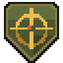
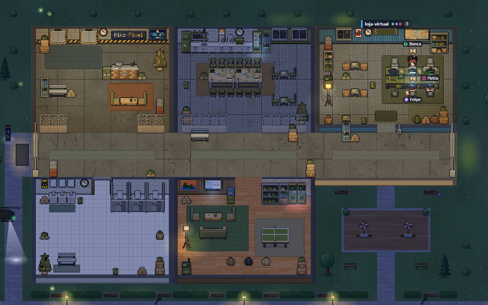
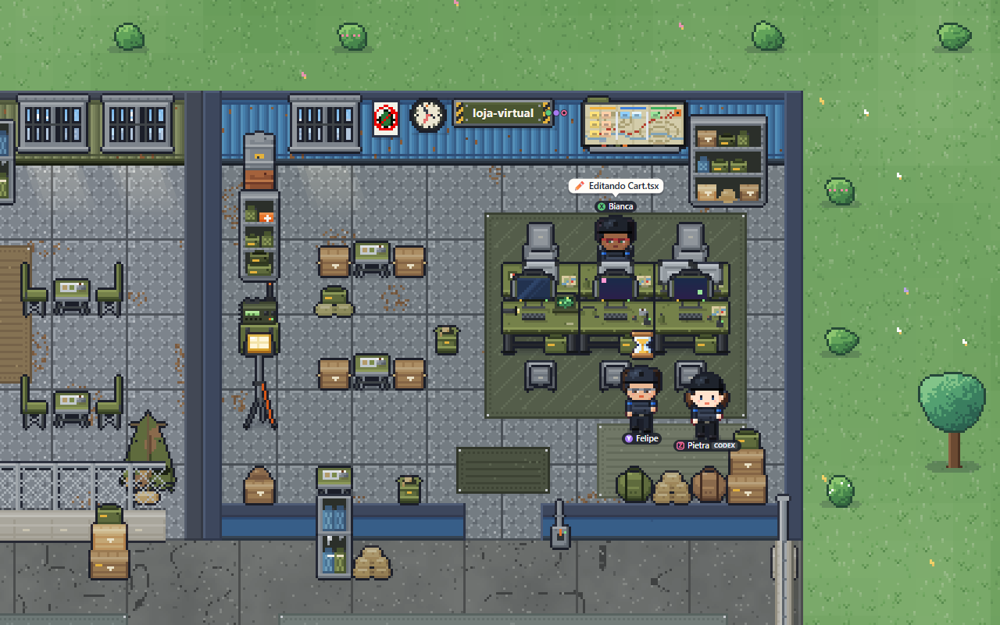
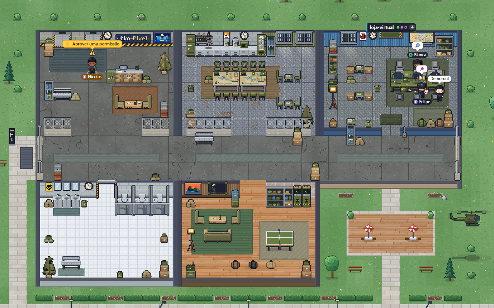
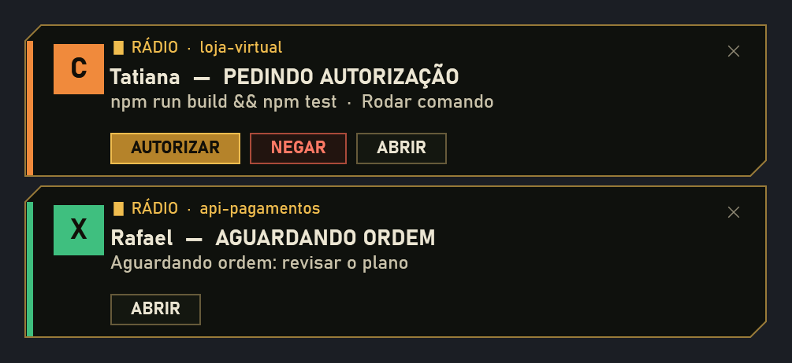
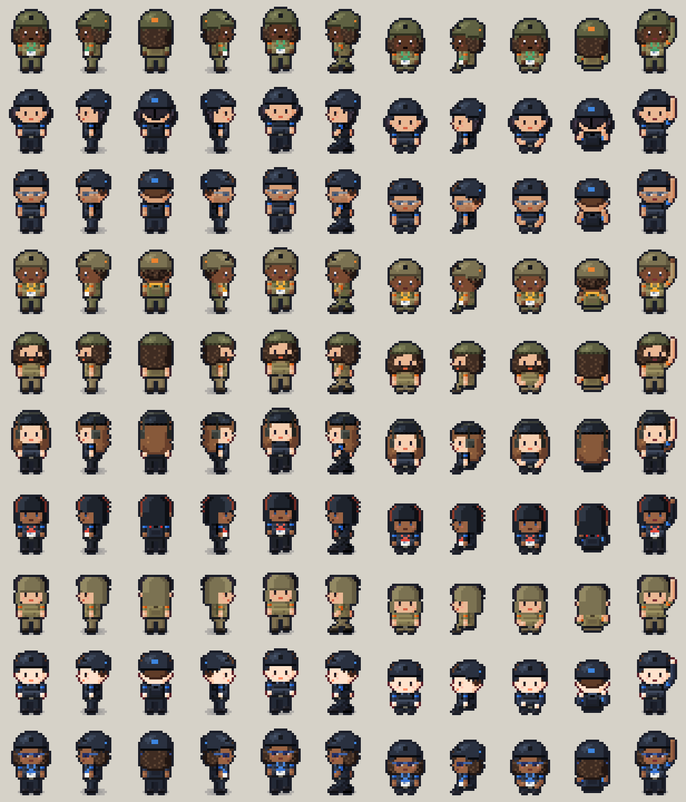
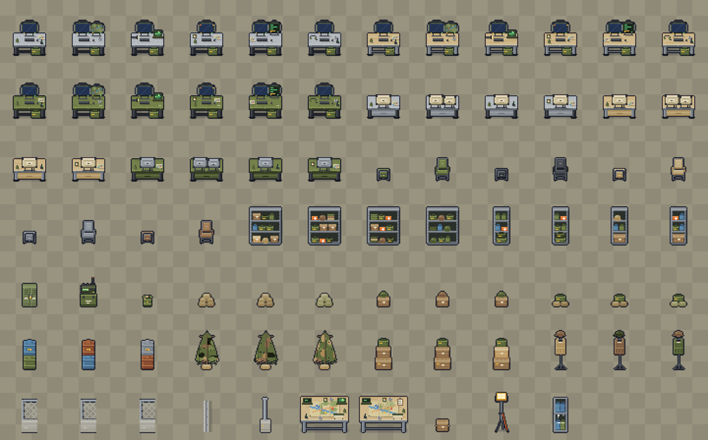
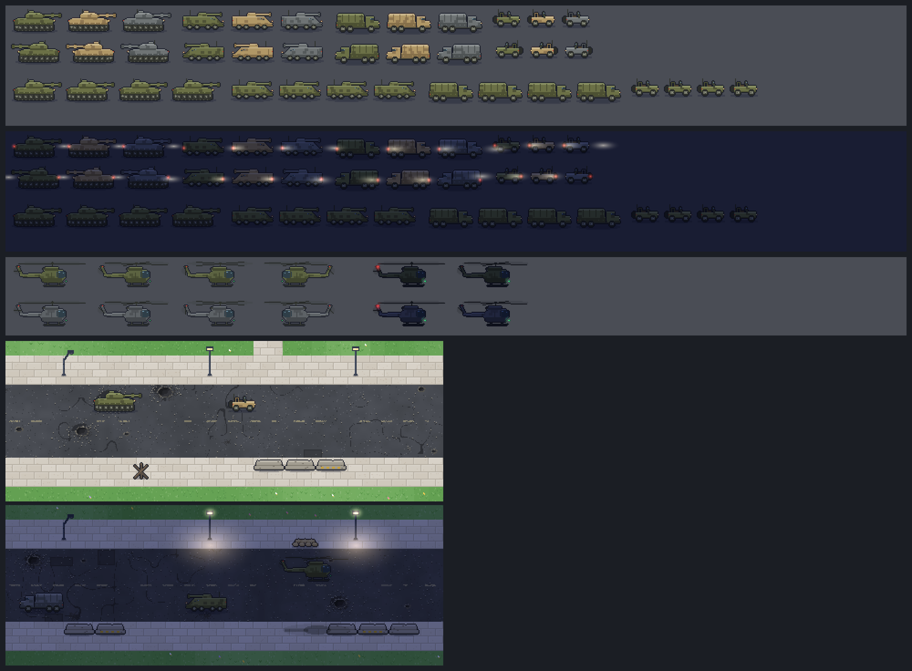

<p align="center">
  
</p>

<h1 align="center">Niko-Pixel</h1>

<p align="center">
  <b>Le quartier général tactique de vos agents d’IA.</b><br />
  Chaque projet devient une zone de la base, et chaque agent Claude Code, Codex, OpenCode ou Gemini CLI devient un
  opérateur en pixel art qui montre, en temps réel, ce qu’il fait.
</p>

<p align="center"><a href="README.md">English</a> · <a href="README.pt-BR.md">Português</a> · <a href="README.es.md">Español</a> · <b>Français</b></p>

<p align="center">
  
  
  
  
  
</p>

<p align="center">
  
</p>

---

Vous ouvrez Claude Code dans plusieurs projets, lancez des sous-agents, laissez des tâches tourner… et perdez le fil de
qui fait quoi. **Niko-Pixel** transforme tout cela en une base lisible d’un coup d’œil : qui est **en action**, qui
**attend les ordres** (a besoin de vous), qui a **atteint l’objectif**, et combien vous avez consommé de chaque compte
sur la session de 5 heures et sur la semaine.

Quand quelqu’un a besoin de vous, la **Radio** apparaît en haut de l’écran, même navigateur réduit, et vous autorisez ou
refusez sur place.

Tout tourne sur votre ordinateur, en lisant les fichiers que les outils écrivent déjà. Rien ne quitte votre machine.

## Sommaire

- [À quoi ça ressemble](#à-quoi-ça-ressemble)
- [Fonctionnalités](#fonctionnalités)
- [Installation](#installation)
- [Radio : alertes en haut de l’écran](#radio--alertes-en-haut-de-lécran)
- [IA prises en charge](#ia-prises-en-charge)
- [Configuration](#configuration)
- [Mettre à jour et désinstaller](#mettre-à-jour-et-désinstaller)
- [Confidentialité](#confidentialité)
- [Dépannage](#dépannage)
- [Développement](#développement)
- [Crédits et licence](#crédits-et-licence)

## À quoi ça ressemble

<table>
  <tr>
    <td width="50%"></td>
    <td width="50%"></td>
  </tr>
  <tr>
    <td><b>Zone de projet</b> : tables de campagne, râteliers à munitions, sacs de sable et les opérateurs au travail.</td>
    <td><b>Quartier général</b> : checkpoint, cantine, vestiaire, salle de détente et une zone par projet ouvert.</td>
  </tr>
</table>

<p align="center">
  
</p>

<table>
  <tr>
    <td width="33%"></td>
    <td width="33%"></td>
    <td width="33%"></td>
  </tr>
</table>

## Fonctionnalités

- **Une zone par projet, un opérateur par agent.** L’opérateur tape quand l’agent travaille, lève la main quand il a
  besoin de vous, tient la position pendant qu’une commande tourne et s’en va quand il a fini. Les sous-agents
  apparaissent comme des renforts.
- **Radio** : une alerte en haut de l’écran avec **Autoriser**, **Refuser** et **Ouvrir** (Windows).
- **Consommation des comptes en direct** : session de 5 heures et semaine, par compte, avec le mod dans Claude Code.
- **Répondre depuis le QG** : approuver ou refuser des permissions, répondre aux questions et envoyer des ordres radio
  (messages) aux agents sans revenir au terminal.
- **Journal de combat** : tout ce qu’a fait chaque opérateur, en direct, avec le rapport des missions de chaque jour.
- **Thèmes du quartier général** : Aucun (la base propre), Guerre (base en alerte), Destruction (base touchée) et
  Automatique, où chaque zone réagit à ses opérateurs.
- **Un look tactique original** : sols de sable, de tôle et de béton ; conteneurs, bunkers et sacs de sable ; deux
  escouades en uniforme ; chars et hélicoptère qui passent dehors ; HUD noir olive avec des icônes militaires.
- **Vie sociale** : au repos, les opérateurs jouent au ping-pong, regardent le foot, misent l’argent de la manche à
  pierre-feuille-ciseaux et discutent à la cantine.
- **Timelapse de la journée**, **ma journée** (où est passé le temps), **terminal dans le navigateur**, **accès depuis le
  téléphone**.
- Interface en **français, anglais, portugais et espagnol**.

## Installation

### Prérequis

- **Windows 10 ou 11** (testé). macOS et Linux fonctionnent aussi (la Radio est réservée à Windows).
- **[Node.js](https://nodejs.org) 22.12 ou plus récent** (22.13+ pour OpenCode).
- **[Git](https://git-scm.com)**.
- **[Claude Code](https://code.claude.com)** 2.1.287 ou plus récent, pour le mod (consommation en direct et
  approbations).

### Windows (une seule commande)

Ouvrez **PowerShell** et lancez :

```powershell
git clone https://github.com/LordSigfrid/niko-pixel.git
cd niko-pixel
powershell -ExecutionPolicy Bypass -File scripts\install-windows.ps1
```

L’installateur :

1. installe les dépendances et compile ;
2. installe le mod dans Claude Code (consommation en direct, Autoriser/Refuser depuis la Radio, messages) ;
3. crée un raccourci dans le dossier **Démarrage** : Niko-Pixel se lance tout seul, sans fenêtre, à chaque ouverture de
   session Windows ;
4. démarre le serveur tout de suite.

Ouvrez ensuite **http://localhost:4747**. Dans les sessions Claude Code déjà ouvertes, lancez `/reload-plugins`.

> `-ExecutionPolicy Bypass` ne vaut que pour ce script : la stratégie d’exécution de Windows ne change pas. Les journaux
> vont dans `%USERPROFILE%\.niko-pixel\servidor.log`.

### macOS et Linux

```bash
git clone https://github.com/LordSigfrid/niko-pixel.git
cd niko-pixel
npm install
npm run build
npm run mod:install
npm start
```

Ouvrez **http://localhost:4747**.

### Docker (facultatif, pour le laisser toujours allumé)

```bash
npm run docker:up
```

Il détecte vos comptes, monte uniquement les dossiers nécessaires (en lecture seule) et démarre le conteneur, qui
redémarre avec Docker. Plus de détails, Codex et accès depuis le téléphone dans
[docs/REFERENCE-fr.md](docs/REFERENCE-fr.md#installation).

## Radio : alertes en haut de l’écran

Quand un opérateur attend les ordres, une carte tactique apparaît **en haut de l’écran**, au-dessus des autres fenêtres
et sans voler le focus de là où vous tapez, même navigateur **réduit ou fermé**.

- **Demande de permission** : **AUTORISER** et **REFUSER** répondent à l’agent sur place. Le terminal reste valable : la
  première réponse l’emporte.
- **Question ou attente** : **OUVRIR** vous amène à Niko-Pixel.
- **✕** la masque jusqu’à la prochaine demande. Plusieurs demandes s’empilent, chacune avec la couleur et la lettre de
  son escouade.

Windows uniquement (elle utilise le WPF fourni avec Windows ; rien à installer). Pour la désactiver :
`NIKO_PIXEL_RADIO=0`. Autoriser et Refuser nécessitent le mod.

## IA prises en charge

| Outil | Ce qui s’affiche | État |
|---|---|---|
| **Claude Code** | tout : état, outils, sous-agents, tâches, consommation 5 h/semaine, approbations et messages | complet |
| **Codex** | état, outils, approbations ; messages avec `codex` dans le PATH | complet |
| **OpenCode** | sessions, état et le modèle dans le rôle de l’opérateur (**DeepSeek**, Gemini, GPT et d’autres modèles utilisés via OpenCode) | lecture seule |
| **Gemini CLI** | sessions et état | lecture seule, expérimental |
| **Qwen Code** | sessions et état | lecture seule, expérimental |

> DeepSeek n’a pas d’agent de terminal à lui : il apparaît quand vous l’utilisez via OpenCode. Gemini CLI et Qwen Code
> ont été faits à partir du format connu de leurs fichiers et n’ont pas encore été testés avec de vraies données :
> ouvrez une issue si quelque chose n’apparaît pas.

## Configuration

Variables d’environnement (sous Windows, définissez-les avant de lancer l’installateur ou dans vos variables
utilisateur) :

| Variable | Rôle | Par défaut |
|---|---|---|
| `NIKO_PIXEL_PORT` | port du serveur (le mod utilise le même) | `4747` |
| `NIKO_PIXEL_RADIO` | `0` désactive la Radio | active sous Windows |
| `NIKO_PIXEL_CLAUDE_DIRS` | dossiers des comptes Claude Code, séparés par des virgules | détecte `~/.claude*` |
| `NIKO_PIXEL_OPENCODE_DIRS`, `NIKO_PIXEL_GEMINI_DIRS`, `NIKO_PIXEL_QWEN_DIRS` | dossiers de ces outils | le dossier par défaut de chacun |
| `NIKO_PIXEL_OPENCODE`, `NIKO_PIXEL_GEMINI`, `NIKO_PIXEL_QWEN`, `NIKO_PIXEL_CODEX` | `0` désactive chaque outil | actifs |
| `NIKO_PIXEL_RECENT_MIN` | minutes pendant lesquelles une session inactive (OpenCode/Gemini/Qwen) reste dans la base | `30` |
| `NIKO_PIXEL_UPDATE_CHECK` | `0` désactive l’avis de nouvelle version | actif |
| `NIKO_PIXEL_LANG` | langue des textes du serveur : activités et avis (`pt`, `en`, `es`, `fr`) ; l’interface a son propre réglage | celle du système |

La liste complète (terminal interactif, téléphone, Docker, permissions) se trouve dans
[docs/REFERENCE-fr.md](docs/REFERENCE-fr.md#configuration).

**Revenir au look de bureau classique :** `TACTICAL_THEME = false` dans `client/src/art/theme.ts`,
`TACTICAL_UNIFORMS = false` dans `client/src/art/character/tactical.ts`, et retirez l’import de `ui/tactical-hud.css`
dans `client/src/ui/index.ts` ; puis `npm run build`.

## Mettre à jour et désinstaller

**Mettre à jour** (dans le dossier du projet) :

```powershell
git pull
powershell -ExecutionPolicy Bypass -File scripts\install-windows.ps1
```

Sous macOS/Linux : `git pull && npm install && npm run build && npm run mod:install` puis relancez `npm start`.
Niko-Pixel vous prévient dans l’interface quand une nouvelle version sort.

**Désinstaller sous Windows** (retire le raccourci, arrête le serveur et désinstalle le mod ; le dossier et les données
restent) :

```powershell
powershell -ExecutionPolicy Bypass -File scripts\install-windows.ps1 -Desinstalar
```

Sous macOS/Linux : `npm run mod:uninstall` puis supprimez le dossier. Les données sont dans `~/.niko-pixel`.

## Confidentialité

- Tout tourne **sur votre ordinateur**. Niko-Pixel ne lit que les fichiers locaux que Claude Code, Codex, OpenCode,
  Gemini CLI et Qwen Code écrivent déjà (sessions, transcriptions, réglages des comptes) et **ne lit jamais
  d’identifiants**.
- Le serveur n’accepte que les connexions de votre propre ordinateur (sauf si vous activez l’accès depuis le téléphone).
- Le seul appel externe est la vérification de nouvelle version : une requête anonyme à l’API publique de GitHub
  (`api.github.com/repos/LordSigfrid/niko-pixel/releases/latest`). Désactivez-la avec `NIKO_PIXEL_UPDATE_CHECK=0`.

## Dépannage

- **« l’exécution de scripts est désactivée sur ce système »** en lançant `npm` : utilisez l’installateur ci-dessus (il
  contourne déjà le problème), ou lancez `npm.cmd` au lieu de `npm`.
- **La page ne s’ouvre pas** : consultez `%USERPROFILE%\.niko-pixel\servidor-erros.log`. Si un autre programme occupe le
  port 4747, définissez `NIKO_PIXEL_PORT`.
- **Autoriser/Refuser ne font rien** : vérifiez le mod avec `npm run mod:status` et lancez `/reload-plugins` dans les
  sessions ouvertes.
- **Un opérateur n’apparaît pas** : Niko-Pixel montre les sessions ouvertes en ce moment (et, pour OpenCode/Gemini/Qwen,
  celles actives dans les 30 dernières minutes).

Plus de cas dans [docs/REFERENCE-fr.md](docs/REFERENCE-fr.md#dépannage).

## Développement

```bash
npm install
npm run dev          # serveur + Vite avec rechargement automatique
npm test             # tests (vitest)
npm run typecheck
npm run i18n:check   # traductions dans shared/locales
```

Le serveur (`server/`) est en Node pur, sans dépendance d’exécution ; la page (`client/`) est en TypeScript avec canvas,
et tout l’art est dessiné par le code (`client/src/art`). Voir [CONTRIBUTING.md](CONTRIBUTING.md) et
[CHANGELOG.md](CHANGELOG.md).

## Crédits et licence

Niko-Pixel est basé sur [Habblaud](https://github.com/marmottajr/habblaud), de Márcio Junior, également sous licence
MIT. Le thème tactique, la Radio, la prise en charge d’OpenCode/Gemini CLI/Qwen Code et l’installateur Windows sont
propres à Niko-Pixel.

[MIT](LICENSE). Projet indépendant, **ni affilié, ni sponsorisé, ni approuvé par Anthropic, OpenAI, Google ou un
quelconque studio de jeux vidéo**. « Claude » et « Claude Code » sont des marques d’Anthropic, utilisées uniquement pour
décrire avec quoi le projet fonctionne. Tout l’art du thème tactique est original.
