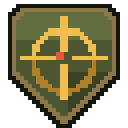
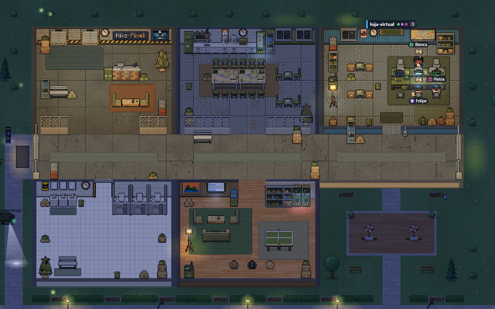
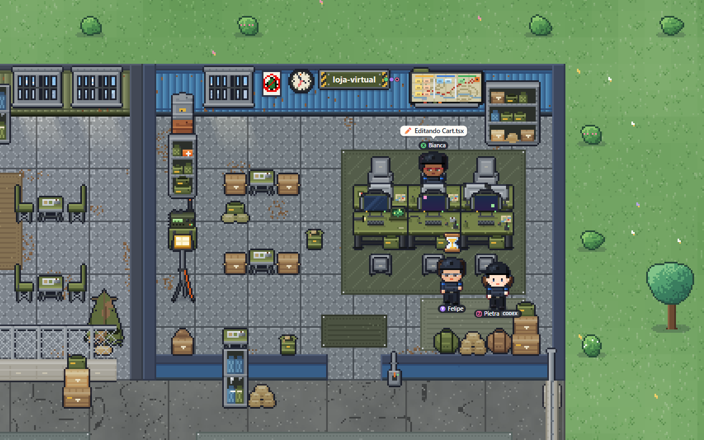
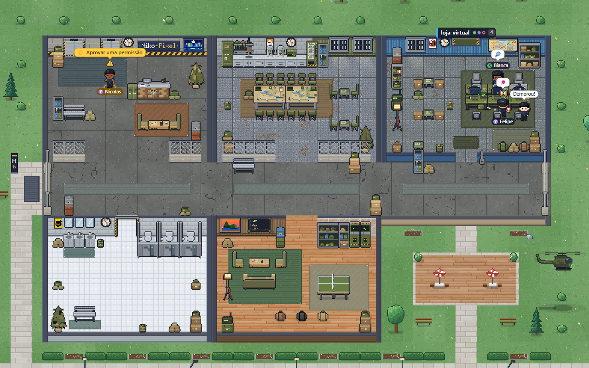
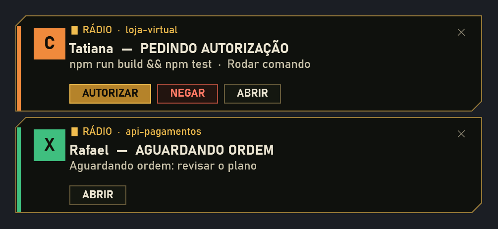
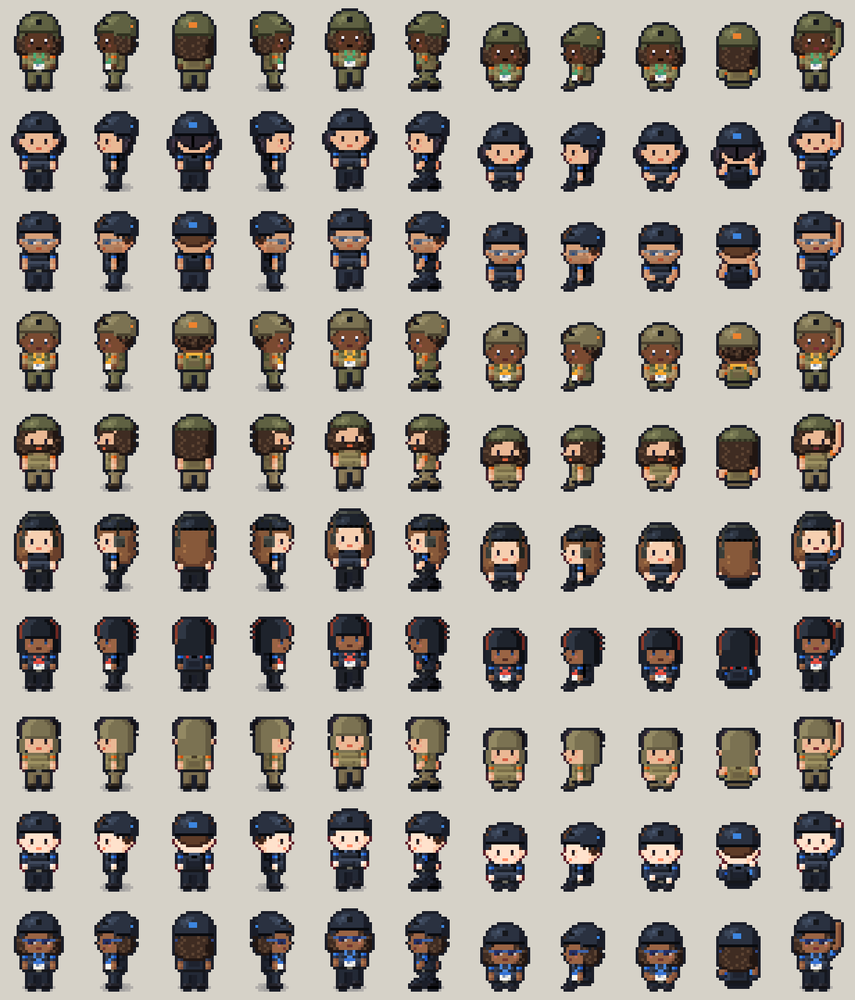
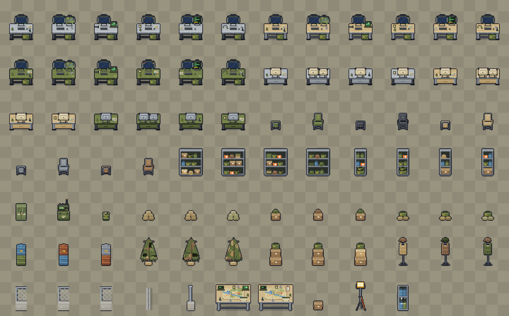
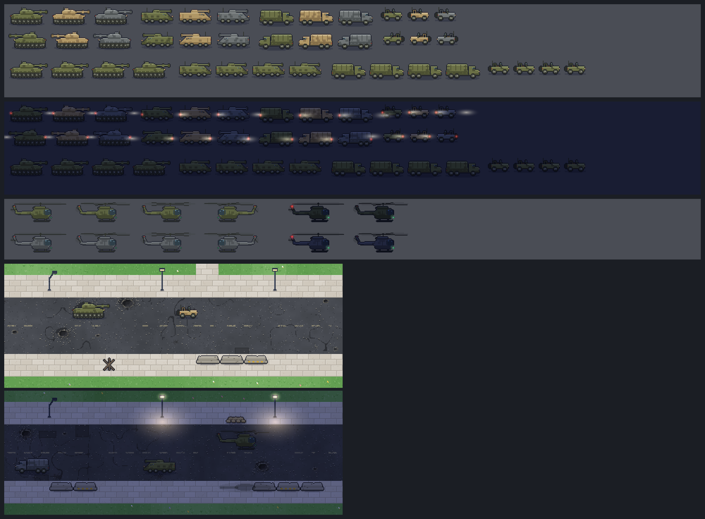

<p align="center">
  
</p>

<h1 align="center">Niko-Pixel</h1>

<p align="center">
  <b>The tactical headquarters for your AI agents.</b><br />
  Each project becomes a zone of the base, and each Claude Code, Codex, OpenCode or Gemini CLI agent becomes a
  pixel-art operator that shows, in real time, what it's doing.
</p>

<p align="center"><b>English</b> · <a href="README.pt-BR.md">Português</a> · <a href="README.es.md">Español</a> · <a href="README.fr.md">Français</a></p>

<p align="center">
  
  
  
  
  
</p>

<p align="center">
  
</p>

---

You open Claude Code in several projects, launch subagents, leave tasks running… and lose track of who's doing what.
**Niko-Pixel** turns all of that into a base you can take in at a glance: who's **in action**, who's **awaiting
orders** (needs you), who **completed the objective**, and how much of each account you've used in the 5-hour session
and in the week.

When someone needs you, the **Radio** pops up at the top of your screen, even with the browser minimized, and you can
authorize or deny right there.

Everything runs on your computer, reading the files the tools already write. Nothing leaves your machine.

## Contents

- [What it looks like](#what-it-looks-like)
- [Features](#features)
- [Installation](#installation)
- [Radio: alerts at the top of the screen](#radio-alerts-at-the-top-of-the-screen)
- [Supported AIs](#supported-ais)
- [Configuration](#configuration)
- [Updating and uninstalling](#updating-and-uninstalling)
- [Privacy](#privacy)
- [Troubleshooting](#troubleshooting)
- [Development](#development)
- [Credits and license](#credits-and-license)

## What it looks like

<table>
  <tr>
    <td width="50%"></td>
    <td width="50%"></td>
  </tr>
  <tr>
    <td><b>Project zone</b>: field tables, ammo racks, sandbags and the operators at work.</td>
    <td><b>Headquarters</b>: checkpoint, mess hall, locker room, rec room and one zone per open project.</td>
  </tr>
</table>

<p align="center">
  
</p>

<table>
  <tr>
    <td width="33%"></td>
    <td width="33%"></td>
    <td width="33%"></td>
  </tr>
</table>

## Features

- **One zone per project, one operator per agent.** The operator types while the agent works, raises a hand when it
  needs you, holds position while a command runs and leaves when it's done. Subagents show up as reinforcements.
- **Radio**: an alert at the top of the screen with **Authorize**, **Deny** and **Open** (Windows).
- **Live account usage**: 5-hour session and weekly usage per account, with the mod in Claude Code.
- **Answer from headquarters**: approve or deny permissions, answer questions and send radio orders (messages) to the
  agents without going back to the terminal.
- **Combat log**: everything each operator did, live, plus each day's mission reports.
- **Headquarters themes**: None (the clean base), War (base on alert), Destruction (base under attack) and Automatic,
  where each zone reacts to its operators.
- **Original tactical look**: sand, steel-plate and concrete floors; containers, bunkers and sandbags; two uniformed
  teams; tanks and a helicopter passing outside; an olive-black HUD with military icons.
- **Social life**: when idle, operators play ping-pong, watch soccer, bet their round money on rock-paper-scissors and
  chat in the mess hall.
- **Day timelapse**, **my day** (where the time went), **terminal in the browser**, **phone access**.
- **English, Portuguese, Spanish and French** interface.

## Installation

### Requirements

- **Windows 10 or 11** (tested). macOS and Linux work too (the Radio is Windows-only).
- **[Node.js](https://nodejs.org) 22.12 or newer** (22.13+ for OpenCode).
- **[Git](https://git-scm.com)**.
- **[Claude Code](https://code.claude.com)** 2.1.287 or newer, for the mod (live usage and approvals).

### Windows (one command)

Open **PowerShell** and run:

```powershell
git clone https://github.com/LordSigfrid/niko-pixel.git
cd niko-pixel
powershell -ExecutionPolicy Bypass -File scripts\install-windows.ps1
```

The installer:

1. installs the dependencies and builds;
2. installs the mod in Claude Code (live usage, Authorize/Deny from the Radio, messages);
3. creates a shortcut in the **Startup** folder: Niko-Pixel starts on its own, with no window, every time you sign in
   to Windows;
4. starts the server right away.

Then open **http://localhost:4747**. In Claude Code sessions that were already open, run `/reload-plugins`.

> `-ExecutionPolicy Bypass` applies to that script only: Windows' execution policy doesn't change. Logs go to
> `%USERPROFILE%\.niko-pixel\servidor.log`.

### macOS and Linux

```bash
git clone https://github.com/LordSigfrid/niko-pixel.git
cd niko-pixel
npm install
npm run build
npm run mod:install
npm start
```

Open **http://localhost:4747**.

### Docker (optional, to keep it always on)

```bash
npm run docker:up
```

It detects your accounts, mounts only the folders it needs (read-only) and starts the container, which restarts along
with Docker. More details, Codex and phone access in [docs/REFERENCE.md](docs/REFERENCE.md#installation).

## Radio: alerts at the top of the screen

When an operator is awaiting orders, a tactical card shows up at the **top of the screen**, above other windows and
without stealing focus from where you're typing, even with the browser **minimized or closed**.

- **Permission request**: **AUTHORIZE** and **DENY** answer the agent right there. The terminal still works: whichever
  answer comes first wins.
- **Question or wait**: **OPEN** takes you to Niko-Pixel.
- **✕** dismisses it until the next request. Several requests stack up, each with its team's color and letter.

Windows only (it uses the WPF that ships with Windows; nothing to install). To turn it off: `NIKO_PIXEL_RADIO=0`.
Authorize and Deny need the mod installed.

## Supported AIs

| Tool | What shows up | Status |
|---|---|---|
| **Claude Code** | everything: status, tools, subagents, tasks, 5-hour/weekly usage, approvals and messages | full |
| **Codex** | status, tools, approvals; messages with `codex` on the PATH | full |
| **OpenCode** | sessions, status and the model in the operator's role (**DeepSeek**, Gemini, GPT and other models used through OpenCode) | read-only |
| **Gemini CLI** | sessions and status | read-only, experimental |
| **Qwen Code** | sessions and status | read-only, experimental |

> DeepSeek has no terminal agent of its own: it shows up when you use it through OpenCode. Gemini CLI and Qwen Code
> support was built from their known file formats and hasn't been tested with real data yet: open an issue if something
> doesn't show up.

## Configuration

Environment variables (on Windows, set them before running the installer or in your user environment variables):

| Variable | What it does | Default |
|---|---|---|
| `NIKO_PIXEL_PORT` | server port (the mod uses the same one) | `4747` |
| `NIKO_PIXEL_RADIO` | `0` turns the Radio off | on, on Windows |
| `NIKO_PIXEL_CLAUDE_DIRS` | Claude Code account folders, comma-separated | detects `~/.claude*` |
| `NIKO_PIXEL_OPENCODE_DIRS`, `NIKO_PIXEL_GEMINI_DIRS`, `NIKO_PIXEL_QWEN_DIRS` | folders for those tools | each tool's default folder |
| `NIKO_PIXEL_OPENCODE`, `NIKO_PIXEL_GEMINI`, `NIKO_PIXEL_QWEN`, `NIKO_PIXEL_CODEX` | `0` turns each tool off | on |
| `NIKO_PIXEL_RECENT_MIN` | minutes an idle session (OpenCode/Gemini/Qwen) stays in the base | `30` |
| `NIKO_PIXEL_UPDATE_CHECK` | `0` turns off the new-version notice | on |
| `NIKO_PIXEL_LANG` | language of server texts: activities and notices (`pt`, `en`, `es`, `fr`); the interface has its own setting | the system's |

The full list (interactive terminal, phone, Docker, permissions) is in
[docs/REFERENCE.md](docs/REFERENCE.md#configuration).

**Back to the classic office look:** `TACTICAL_THEME = false` in `client/src/art/theme.ts`,
`TACTICAL_UNIFORMS = false` in `client/src/art/character/tactical.ts`, and remove the `ui/tactical-hud.css` import in
`client/src/ui/index.ts`; then `npm run build`.

## Updating and uninstalling

**Update** (in the project folder):

```powershell
git pull
powershell -ExecutionPolicy Bypass -File scripts\install-windows.ps1
```

On macOS/Linux: `git pull && npm install && npm run build && npm run mod:install` and restart `npm start`. Niko-Pixel
tells you in the interface when a new version is out.

**Uninstall on Windows** (removes the shortcut, stops the server and removes the mod; the folder and data stay):

```powershell
powershell -ExecutionPolicy Bypass -File scripts\install-windows.ps1 -Desinstalar
```

On macOS/Linux: `npm run mod:uninstall` and delete the folder. Data lives in `~/.niko-pixel`.

## Privacy

- Everything runs **on your computer**. Niko-Pixel reads only the local files that Claude Code, Codex, OpenCode,
  Gemini CLI and Qwen Code already write (sessions, transcripts, account settings) and **never reads credentials**.
- The server only accepts connections from your own computer (unless you turn on phone access).
- The only external call is the new-version check: an anonymous request to GitHub's public API
  (`api.github.com/repos/LordSigfrid/niko-pixel/releases/latest`). Turn it off with `NIKO_PIXEL_UPDATE_CHECK=0`.

## Troubleshooting

- **"running scripts is disabled on this system"** when running `npm`: use the installer above (it already works around
  this), or run `npm.cmd` instead of `npm`.
- **The page doesn't open**: check `%USERPROFILE%\.niko-pixel\servidor-erros.log`. If port 4747 is taken by another
  program, set `NIKO_PIXEL_PORT`.
- **Authorize/Deny do nothing**: check the mod with `npm run mod:status` and run `/reload-plugins` in open sessions.
- **An operator doesn't show up**: Niko-Pixel shows the sessions open right now (and, for OpenCode/Gemini/Qwen, the ones
  active in the last 30 minutes).

More cases in [docs/REFERENCE.md](docs/REFERENCE.md#troubleshooting).

## Development

```bash
npm install
npm run dev          # server + Vite with hot reload
npm test             # tests (vitest)
npm run typecheck
npm run i18n:check   # translations in shared/locales
```

The server (`server/`) is plain Node with zero runtime dependencies; the page (`client/`) is TypeScript with canvas,
and all the art is drawn by code (`client/src/art`). See [CONTRIBUTING.md](CONTRIBUTING.md) and
[CHANGELOG.md](CHANGELOG.md).

## Credits and license

Niko-Pixel is based on [Habblaud](https://github.com/marmottajr/habblaud) by Márcio Junior, also under the MIT license.
The tactical theme, the Radio, OpenCode/Gemini CLI/Qwen Code support and the Windows installer are Niko-Pixel's.

[MIT](LICENSE). An independent project, **not affiliated with, sponsored or endorsed by Anthropic, OpenAI, Google or any
game studio**. "Claude" and "Claude Code" are trademarks of Anthropic, used only to describe what the project works
with. All tactical-theme art is original.
