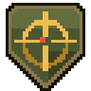
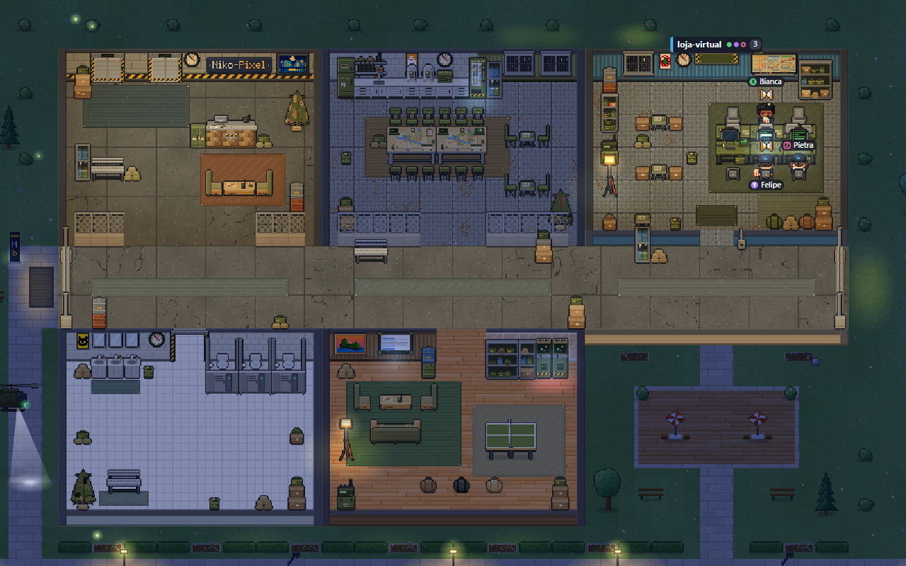
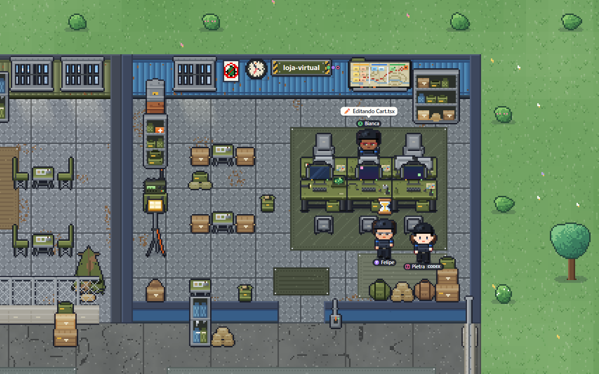
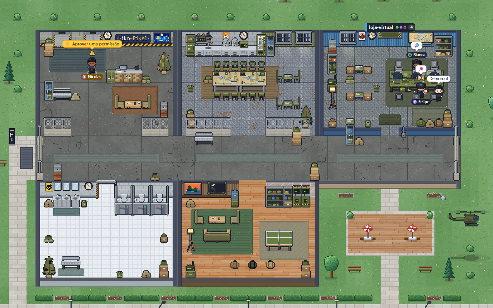
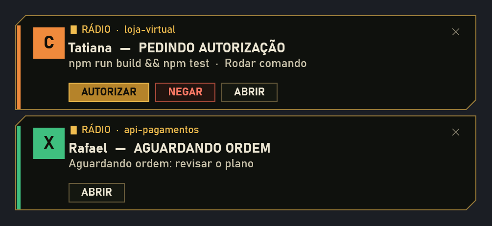
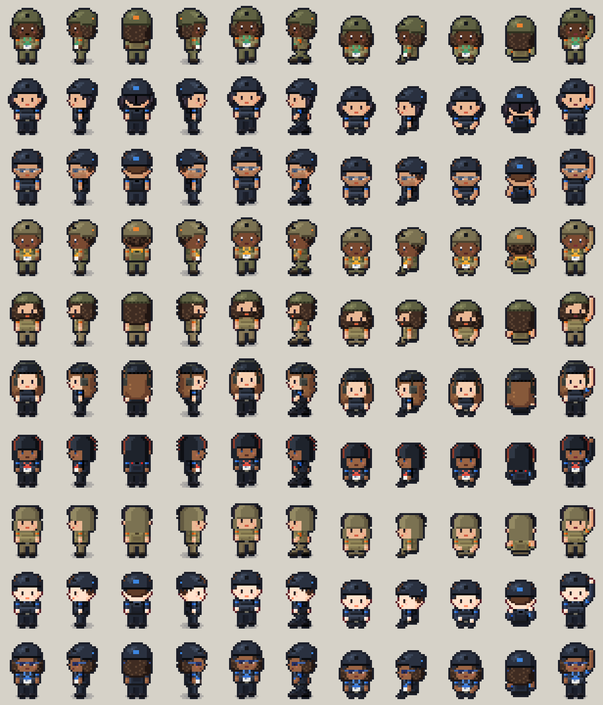
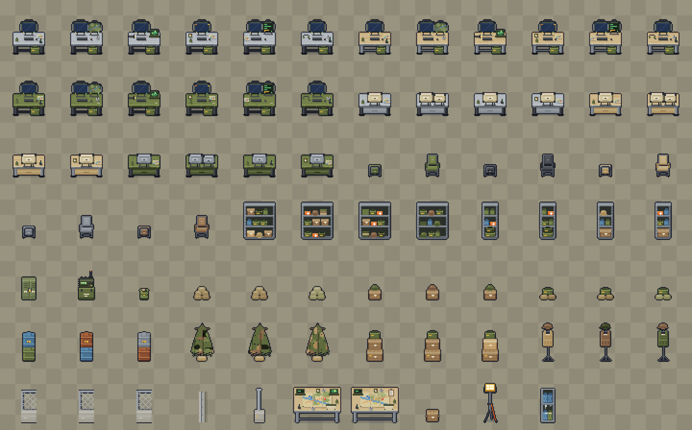
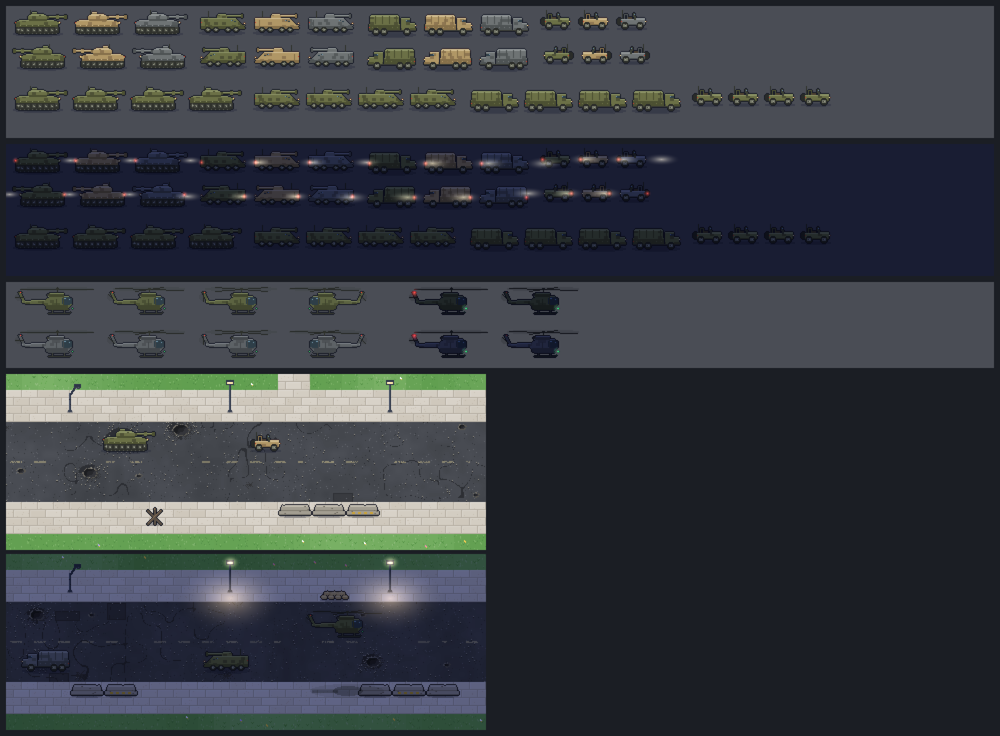

<p align="center">
  
</p>

<h1 align="center">Niko-Pixel</h1>

<p align="center">
  <b>O quartel-general tático dos seus agentes de IA.</b><br />
  Cada projeto vira uma zona da base, e cada agente do Claude Code, Codex, OpenCode ou Gemini CLI vira um operador em
  pixel art que mostra, em tempo real, o que está fazendo.
</p>

<p align="center"><a href="README.md">English</a> · <b>Português</b> · <a href="README.es.md">Español</a> · <a href="README.fr.md">Français</a></p>

<p align="center">
  
  
  
  
  
</p>

<p align="center">
  
</p>

---

Você abre o Claude Code em vários projetos, dispara subagentes, deixa tarefas rodando… e perde a noção de quem está
fazendo o quê. O **Niko-Pixel** transforma tudo isso numa base que dá para entender de relance: quem está **em ação**,
quem está **aguardando ordem** (precisa de você), quem **concluiu o objetivo** e quanto de cada conta você já usou na
sessão de 5 horas e na semana.

Quando alguém precisa de você, o **Rádio** aparece no topo da tela, mesmo com o navegador minimizado, e você autoriza ou
nega dali mesmo.

Tudo roda no seu computador, lendo os arquivos que as próprias ferramentas já gravam. Nada sai da máquina.

## Sumário

- [Como é](#como-é)
- [Recursos](#recursos)
- [Instalação](#instalação)
- [Rádio: alertas no topo da tela](#rádio-alertas-no-topo-da-tela)
- [IAs suportadas](#ias-suportadas)
- [Configuração](#configuração)
- [Atualizar e desinstalar](#atualizar-e-desinstalar)
- [Privacidade](#privacidade)
- [Problemas comuns](#problemas-comuns)
- [Desenvolvimento](#desenvolvimento)
- [Créditos e licença](#créditos-e-licença)

## Como é

<table>
  <tr>
    <td width="50%"></td>
    <td width="50%"></td>
  </tr>
  <tr>
    <td><b>Zona de projeto</b>: mesas de campanha, racks de munição, sacos de areia e os operadores trabalhando.</td>
    <td><b>Quartel-general</b>: checkpoint, rancho, vestiário, recreação e uma zona para cada projeto aberto.</td>
  </tr>
</table>

<p align="center">
  
</p>

<table>
  <tr>
    <td width="33%"></td>
    <td width="33%"></td>
    <td width="33%"></td>
  </tr>
</table>

## Recursos

- **Uma zona por projeto, um operador por agente.** O operador digita quando o agente trabalha, levanta a mão quando
  precisa de você, segura posição enquanto um comando roda e sai quando termina. Subagentes aparecem como reforços.
- **Rádio**: alerta no topo da tela com **Autorizar**, **Negar** e **Abrir** (Windows).
- **Uso das contas ao vivo**: sessão de 5 horas e semana, por conta, com o mod no Claude Code.
- **Responder pelo quartel-general**: aprovar ou recusar permissões, responder perguntas e mandar ordens por rádio
  (mensagens) aos agentes, sem voltar ao terminal.
- **Registro de combate**: tudo o que cada operador fez, ao vivo, com o relatório das missões de cada dia.
- **Temas do quartel-general**: Nenhum (a base limpa), Guerra (base em alerta), Destruição (base atingida) e
  Automático, em que cada zona reage aos seus operadores.
- **Visual tático original**: pisos de areia, chapa e concreto; contêineres, bunkers e sacos de areia; duas equipes de
  uniforme; tanques e helicóptero passando lá fora; HUD preto-oliva com ícones militares.
- **Vida social**: quando ficam à toa, os operadores jogam ping-pong, assistem futebol, apostam o dinheiro da rodada no
  jokenpô e conversam no rancho.
- **Timelapse do dia**, **meu dia** (para onde foi o tempo), **terminal pelo navegador**, **acesso pelo celular**.
- **Português, inglês, espanhol e francês** na interface.

## Instalação

### Requisitos

- **Windows 10 ou 11** (testado). macOS e Linux também funcionam (o Rádio é só no Windows).
- **[Node.js](https://nodejs.org) 22.12 ou mais novo** (22.13+ para o OpenCode).
- **[Git](https://git-scm.com)**.
- **[Claude Code](https://code.claude.com)** 2.1.287 ou mais novo, para o mod (uso ao vivo e aprovações).

### Windows (um comando só)

Abra o **PowerShell** e rode:

```powershell
git clone https://github.com/LordSigfrid/niko-pixel.git
cd niko-pixel
powershell -ExecutionPolicy Bypass -File scripts\install-windows.ps1
```

O instalador:

1. instala as dependências e compila;
2. instala o mod no Claude Code (uso ao vivo, Autorizar/Negar pelo Rádio, mensagens);
3. cria um atalho na pasta **Inicializar**: o Niko-Pixel sobe sozinho, sem janela, sempre que você entra no Windows;
4. já inicia o servidor.

Depois abra **http://localhost:4747**. Nas sessões do Claude Code que já estavam abertas, rode `/reload-plugins`.

> O `-ExecutionPolicy Bypass` vale só para esse script: a política de execução do Windows não muda. Os logs ficam em
> `%USERPROFILE%\.niko-pixel\servidor.log`.

### macOS e Linux

```bash
git clone https://github.com/LordSigfrid/niko-pixel.git
cd niko-pixel
npm install
npm run build
npm run mod:install
npm start
```

Abra **http://localhost:4747**.

### Docker (opcional, para deixar sempre ligado)

```bash
npm run docker:up
```

Detecta as suas contas, monta só as pastas necessárias (somente leitura) e sobe o container, que reinicia sozinho com o
Docker. Mais detalhes, Codex e acesso pelo celular em [docs/REFERENCIA.md](docs/REFERENCIA.md#instalação).

## Rádio: alertas no topo da tela

Quando um operador aguarda ordem, uma placa tática aparece no **topo da tela**, por cima das outras janelas e sem
roubar o foco de onde você está digitando, mesmo com o navegador **minimizado ou fechado**.

- **Pedido de permissão**: **AUTORIZAR** e **NEGAR** respondem ao agente ali mesmo. O terminal continua valendo: vale o
  que vier primeiro.
- **Pergunta ou espera**: **ABRIR** leva ao Niko-Pixel.
- **✕** dispensa até o próximo pedido. Vários pedidos se empilham, cada um com a cor e a letra da equipe.

Só no Windows (usa o WPF que já vem no sistema; nada para instalar). Para desligar: `NIKO_PIXEL_RADIO=0`. Autorizar e
Negar precisam do mod instalado.

## IAs suportadas

| Ferramenta | O que aparece | Situação |
|---|---|---|
| **Claude Code** | tudo: status, ferramentas, subagentes, tarefas, uso de 5h/semana, aprovações e mensagens | completo |
| **Codex** | status, ferramentas, aprovações; mensagens com `codex` no PATH | completo |
| **OpenCode** | sessões, status e o modelo no papel do operador (**DeepSeek**, Gemini, GPT e outros modelos usados pelo OpenCode) | só leitura |
| **Gemini CLI** | sessões e status | só leitura, experimental |
| **Qwen Code** | sessões e status | só leitura, experimental |

> O DeepSeek não tem um agente de terminal próprio: ele aparece quando você o usa pelo OpenCode. Gemini CLI e Qwen Code
> foram feitos pelo formato conhecido dos arquivos deles e ainda não foram testados com dados reais: abra uma issue se
> algo não aparecer.

## Configuração

Variáveis de ambiente (no Windows, defina antes de rodar o instalador ou nas variáveis do usuário):

| Variável | Para quê | Padrão |
|---|---|---|
| `NIKO_PIXEL_PORT` | porta do servidor (o mod usa a mesma) | `4747` |
| `NIKO_PIXEL_RADIO` | `0` desliga o Rádio | ligado no Windows |
| `NIKO_PIXEL_CLAUDE_DIRS` | pastas das contas do Claude Code, separadas por vírgula | detecta `~/.claude*` |
| `NIKO_PIXEL_OPENCODE_DIRS`, `NIKO_PIXEL_GEMINI_DIRS`, `NIKO_PIXEL_QWEN_DIRS` | pastas dessas ferramentas | as pastas padrão de cada uma |
| `NIKO_PIXEL_OPENCODE`, `NIKO_PIXEL_GEMINI`, `NIKO_PIXEL_QWEN`, `NIKO_PIXEL_CODEX` | `0` desliga cada ferramenta | ligadas |
| `NIKO_PIXEL_RECENT_MIN` | minutos que uma sessão ociosa (OpenCode/Gemini/Qwen) fica na base | `30` |
| `NIKO_PIXEL_UPDATE_CHECK` | `0` desliga o aviso de versão nova | ligado |
| `NIKO_PIXEL_LANG` | idioma dos textos do servidor: atividades e avisos (`pt`, `en`, `es`, `fr`); a interface escolhe nas Configurações | o do sistema |

A lista completa (terminal interativo, celular, Docker, permissões) está em
[docs/REFERENCIA.md](docs/REFERENCIA.md#configuração).

**Voltar ao visual clássico de escritório:** `TACTICAL_THEME = false` em `client/src/art/theme.ts`,
`TACTICAL_UNIFORMS = false` em `client/src/art/character/tactical.ts` e tire o import de `ui/tactical-hud.css` em
`client/src/ui/index.ts`; depois `npm run build`.

## Atualizar e desinstalar

**Atualizar** (na pasta do projeto):

```powershell
git pull
powershell -ExecutionPolicy Bypass -File scripts\install-windows.ps1
```

No macOS/Linux: `git pull && npm install && npm run build && npm run mod:install` e reinicie o `npm start`. O
Niko-Pixel avisa na interface quando sai uma versão nova.

**Desinstalar no Windows** (tira o atalho, para o servidor e remove o mod; a pasta e os dados ficam):

```powershell
powershell -ExecutionPolicy Bypass -File scripts\install-windows.ps1 -Desinstalar
```

No macOS/Linux: `npm run mod:uninstall` e apague a pasta. Os dados ficam em `~/.niko-pixel`.

## Privacidade

- Tudo roda **no seu computador**. O Niko-Pixel lê só os arquivos locais que o Claude Code, o Codex, o OpenCode, o
  Gemini CLI e o Qwen Code já gravam (sessões, transcripts, configurações das contas) e **nunca lê credenciais**.
- O servidor só aceita conexões do próprio computador (a não ser que você ligue o acesso pelo celular).
- A única chamada externa é o aviso de versão nova: uma consulta anônima à API pública do GitHub
  (`api.github.com/repos/LordSigfrid/niko-pixel/releases/latest`). Desligue com `NIKO_PIXEL_UPDATE_CHECK=0`.

## Problemas comuns

- **"a execução de scripts foi desabilitada"** ao rodar `npm`: use o instalador acima (ele já contorna isso), ou rode
  `npm.cmd` no lugar de `npm`.
- **A página não abre**: veja `%USERPROFILE%\.niko-pixel\servidor-erros.log`. Se a porta 4747 estiver ocupada por outro
  programa, defina `NIKO_PIXEL_PORT`.
- **Autorizar/Negar não fazem nada**: confira o mod com `npm run mod:status` e rode `/reload-plugins` nas sessões abertas.
- **Um operador não aparece**: o Niko-Pixel mostra as sessões abertas agora (e, no OpenCode/Gemini/Qwen, as que tiveram
  atividade nos últimos 30 min).

Mais casos em [docs/REFERENCIA.md](docs/REFERENCIA.md#solução-de-problemas).

## Desenvolvimento

```bash
npm install
npm run dev          # servidor + Vite com recarga automática
npm test             # testes (vitest)
npm run typecheck
npm run i18n:check   # traduções em shared/locales
```

O servidor (`server/`) é Node puro, sem dependências de runtime; a página (`client/`) é TypeScript com canvas, e toda a
arte é desenhada por código (`client/src/art`). Veja o [CONTRIBUTING.md](CONTRIBUTING.md) e o
[CHANGELOG.md](CHANGELOG.md).

## Créditos e licença

O Niko-Pixel é baseado no [Habblaud](https://github.com/marmottajr/habblaud), de Márcio Junior, também sob a licença
MIT. O tema tático, o Rádio, o suporte a OpenCode/Gemini CLI/Qwen Code e o instalador para Windows são do Niko-Pixel.

[MIT](LICENSE). Projeto independente, **não afiliado, patrocinado nem endossado pela Anthropic, pela OpenAI, pelo
Google nem por nenhum estúdio de jogos**. "Claude" e "Claude Code" são marcas da Anthropic, usadas só para descrever
com o que o projeto funciona. Toda a arte do tema tático é original.
